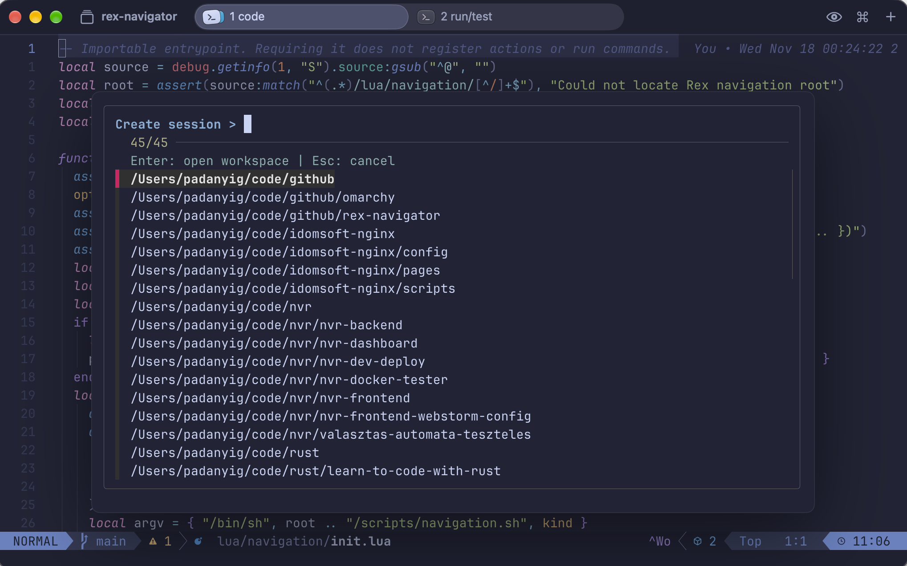
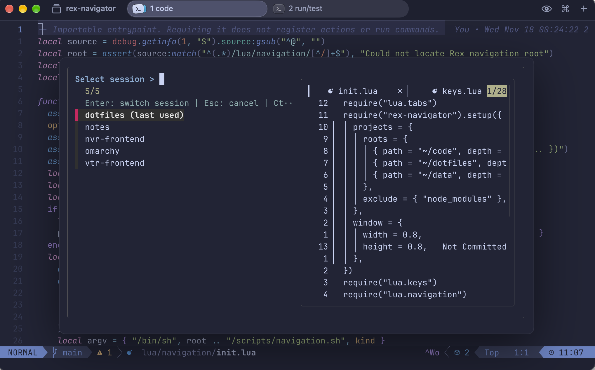

# `rex-navigator`

<a href="https://github.com/fegyi001/rex-navigator">
  
</a>

## About Rex

[Rex](https://www.superlogical.com/rex/docs) is a modern terminal multiplexer
built by [Superlogical](https://www.superlogical.com). The team
includes [Mitchell Hashimoto](https://mitchellh.com/), creator of
[Ghostty](https://ghostty.org/).

## What is `rex-navigator`

`rex-navigator` is an unofficial Rex extension that provides some missing/improved
session navigation features.

## Features

Use `rex-navigator` to:

- create new sessions (based on your favorite directories)
- switch to an existing session
- quickly switch back-and-forth your last-used session

The pickers open in focused floating panes over your
current tab. It uses Rex's embedded Lua and fzf; you don't
need to install anything to use it.

**The action keybindings below are examples.** Choose your own Rex-supported keys
or key sequences in `init.lua`. The examples use **Ctrl+A as a prefix key** to
match the author's previous tmux setup: press Ctrl+A, release it, then press the
next key. **Ctrl+A → f** means Ctrl+A followed by lowercase `f`.

### Create new session

Use `rex_navigator_create_session` (example: **Ctrl+A → f**) to search your configured
project directories. Type to filter, then press **Enter** to create or reuse the
project's Rex session and switch to it. Press **Esc** to cancel.



### Switch to an existing session

Use `rex_navigator_switch_session` (example: **Ctrl+A → Space**) to filter existing sessions
by name and view a terminal preview. The last-used session comes first. Press **Enter** to switch, or **Esc** to cancel.



### Last-used session

Run `rex_navigator_last_used_session` (example: **Ctrl+A → Enter**) to switch back without
opening a picker. After a switch from A to B through either picker, repeat the
action to toggle **B → A → B → A**.

Start by choosing another session with either picker. Rex's sidebar and native
session-switching actions do not update this history. See
[History and limits](#history-and-limits).

## Requirements

- macOS and Rex with the `rex.exec.start`/process-handle Lua functions. **Enable
  Rex Remote Control so the plugin can select sessions in the app.**
- fzf and the macOS tools `lockf`, `find`, `sort`, `realpath`, `openssl`, `mktemp`,
  and `dd` with `conv=fsync` support. Linux and Windows support is not implemented.

The workers look for executables in PATH, Rex's managed macOS installation, and
local/Homebrew locations. They do not source shell startup files.

## Installation

Clone this repository anywhere and symlink it under your Rex configuration root:

```sh
git clone https://github.com/fegyi001/rex-navigator.git ~/code/rex-navigator
ln -s ~/code/rex-navigator ~/.config/rex/rex-navigator
```

Use `$XDG_CONFIG_HOME` instead of `~/.config` if set. A Git submodule at the same
`rex-navigator` path also works. Add this to your Rex `init.lua` and adjust the
project roots and bindings:

```lua
require("rex-navigator").setup({
  projects = {
    roots = {
      { path = "~/code", depth = 2 },
    },
    exclude = { "node_modules" },
  },
})

-- Example bindings: Ctrl+A is the prefix; choose your own keys or sequences.
rex.bind("ctrl+a>space", "rex_navigator_switch_session")
rex.bind("ctrl+a>f", "rex_navigator_create_session")
rex.bind("ctrl+a>enter", "rex_navigator_last_used_session")
```

Call `setup()` once per configuration load to register the three actions. Importing
the module alone has no effects. Keep your settings and bindings in `init.lua`;
the plugin locates its own workers without an extra config file or PATH change.

Rex uses `>` between keys in a sequence: `ctrl+a>f` means **Ctrl+A → f**. Choose a
different prefix, another sequence, or a single shortcut. See Rex's
[key sequences](https://www.superlogical.com/rex/docs/customize/key-sequences) and
[keyboard shortcuts](https://www.superlogical.com/rex/docs/customize/keyboard-shortcuts)
documentation. The plugin leaves existing pane-navigation bindings alone.

After editing `init.lua`, reload the configuration on the Rex server:

```sh
rex config reload
```

## Configuration

Configure project discovery in `setup({ projects = ... })`:

- `roots`: a nonempty list of paths and traversal depths. Use an absolute path,
  `~`, or `~/...`, with a positive integer `depth`. Depth 1 lists immediate child
  directories, not the root itself. Unusable roots produce a warning.
- `exclude`: directory names to skip at any depth, such as `node_modules`.

Discovery skips hidden child directories, files, and directory symlinks. You can
use symlinks as configured roots; the plugin resolves and deduplicates those roots.
Overlapping roots do not produce duplicate candidates.

Setup validates inline settings before registering actions and passes them to
workers without writing a generated config file. Configure projects through
`setup({ projects = ... })`; the plugin does not load separate configuration files.
You can use the session actions without project settings. Project discovery
requires a nonempty `projects.roots` list.

### Floating window size

Set `window.width` and `window.height` to fractions of the invoking tab's size.
Both pickers use these settings and stay centered. Omit either value to use its
default: `0.7` width and `0.6` height. Values must be numbers greater than `0` and
at most `1`.

```lua
require("rex-navigator").setup({
  window = { width = 0.8, height = 0.7 },
  projects = {
    roots = { { path = "~/code", depth = 2 } },
  },
})
```

Add `window` to your existing `setup()` call; do not call setup a second time.

## Picker behavior

Both pickers open a centered pane with focus. The default size is 70% of the
invoking tab's width and 60% of its height. Selecting a result or pressing Esc
closes it; neither picker creates a temporary tab. For picker errors, press Enter
to dismiss the pane.
Rex reports toggle errors through the action.

The session picker excludes the current session. After the last-used destination,
it lists sessions in case-insensitive alphabetical order, with full IDs as tie
breakers. Typing ranks fuzzy matches; clearing the query restores the initial
order. Names and the last-used marker appear in the list, but IDs stay hidden.
Use the preview to distinguish duplicate names. The plugin keeps fzf's default
colors. With no other sessions, you see `No other sessions available`.

## Session snapshots

Highlight a session to preview its focused terminal in the active tab. Shells show
recent output; alternate-screen apps such as Neovim show the top of the screen.
Use **Ctrl+U / Ctrl+D** inside fzf to page the snapshot. These controls do not send
input to the target terminal. Wide layouts may not fit the text preview.

Each highlight change starts a snapshot; the preview does not refresh between
changes. Missing sessions, missing focus, non-terminal panes, and failed or slow
requests show `Preview unavailable`. You can still select the session.

Preview limits:

- Work starts after a 75 ms delay, once the list has opened, with a two-second budget.
- Shell snapshots read a 32 KiB tail and display up to 200 lines within the available
  preview rows. Alternate-screen snapshots read the head with a 32 KiB encoded-byte
  budget and keep up to 200 lines for scrolling.
- Alternate-screen previews show `[Preview truncated]` if byte or line limits cut
  off content.
  The worker strips terminal control sequences and keeps no disk cache.

Previews do not switch sessions, send terminal input, or write history. The worker
uses Rex CLI reads to bound response bytes, which native Lua RPC does not expose.
A short-lived process-group guard checks owner liveness every 50 ms and terminates
descendants after cancellation or owner exit. Cleanup may outlast the preview's
Rex process.

These are client-transfer and display limits. Rex may format full scrollback
before returning a bounded result, so server-side formatting can still take time.

## History and limits

History lives under the plugin root in `state/session-history.json`, alongside
`state/session-history.lock`. Git ignores `/state/`; keep the checkout writable.
Moving the checkout moves its history. Separate checkouts keep separate histories.

Apps using the same checkout share one last-used pair per host. The plugin tracks
session IDs, so renaming a session or reconnecting an app does not reset the pair.
Opening or cancelling a picker, or selecting the current session, leaves it alone.

Rex does not expose a selected-session-change event. Sidebar clicks, the native
session picker, and native next/previous actions do not update this history.
After one of those switches, the toggle returns to the last tracked session and
then alternates with the session you invoked it from. If a target has closed or
you have no history yet, choose another session with either plugin picker.

The session picker's first item matches the toggle destination. Unusable history,
a closed target, or a failed host-status lookup leaves the list in alphabetical
order. Opening the picker reads a history snapshot without locking or writing it.
Ordering adds at most one host-status request with a 500 ms timeout, and none
without nonempty history. The plugin rejects malformed history at switch time
rather than overwriting it. macOS's locale-aware sort determines name order.

Concurrent toggles report a busy error; wait for the active switch to finish.
The transaction worker holds the kernel lock until it exits, even if its
coordinator dies. Writes use a private temporary file, file fsync, and atomic
rename. Use one local Rex server per plugin checkout; sharing a checkout between
server instances is unsupported.

### Older history files

The plugin preserves per-client entries and writes new pairs to the host's
`shared` entry. Before that entry exists, it recovers a legacy pair only if it
contains the invoking session and eligible pairs agree on one live destination.
Conflicts require a picker selection. A successful switch saves the recovered
pair; an existing `shared` entry takes precedence even if its target has closed.

## Project directories

The project picker reuses associations in `$XDG_STATE_HOME/rex/project-sessions.json`,
defaulting to `~/.local/state/rex/project-sessions.json`. Existing associations need
no conversion. With a missing or stale association, it checks local terminal
working directories before creating a session. Multiple matches require manual
selection.

Project creation and registry updates hold a lock to avoid duplicate sessions.
Opens wait up to 20 seconds for that lock. An association survives a refused
switch, so a retry can reuse the created session.

During matching, the worker attaches a temporary inspection stream, reads layout
and cwd metadata, and detaches even after a read error. Inspection does not change
the app's selected session. The worker caches canonical cwd results for that scan.

## Source layout

```text
init.lua          Public require("rex-navigator") entrypoint
lua/navigation/   Actions, configuration, history, projects, previews, and adapters
scripts/          Lua workers and shell adapters
assets/           Logo and screenshots
state/            Gitignored session history and lock
tests/            Isolated tests and helpers
tools/            Development tools, including the Unicode data generator
```

`navigation.sh` starts the Lua worker. `lock-transaction.sh` keeps the kernel lock
in the writer process; `process-group.sh` cleans up subprocess groups on timeout
or cancellation. The plugin starts workers on demand and runs no persistent daemon.

## Tests

From this repository root, run:

```sh
node --test --test-concurrency=2 tests/*.test.mjs
```

For development, install Node.js, Rex, fzf, and a standalone `lua` for the offline
action/install harnesses, plus the macOS tools listed above. No npm packages are
required. Limit test-file concurrency to 2 to reduce process-start timing noise.

Start Rex before running the suite: `rex do` needs an initial server connection
even with fake requests. The harness disables autostart, isolates state, and
rejects live session/client operations. Tests use real Lua workers, kernel locks,
fzf, and private PTYs. Launcher tests poison Node startup to catch production
dependencies on Node.

Check appearance, Remote Control permissions, and live preview responsiveness in
the app; the isolated suite does not verify those. Regenerate the checked-in
`text-data.lua` with `tools/generate-rex-unicode.mjs`; its header records the Unicode
version. The plugin does not run the generator at startup.

## License

Use the code and documentation under the [MIT license](LICENSE). The project logo
incorporates Rex artwork from Superlogical. This license does not cover that
third-party artwork or Rex branding.
